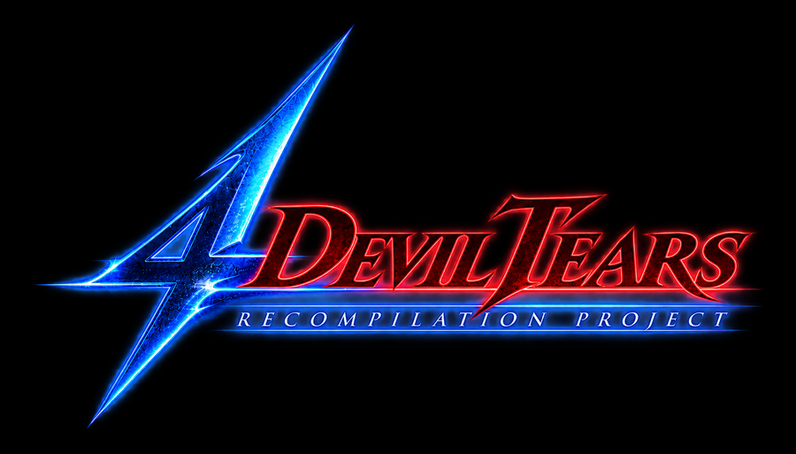
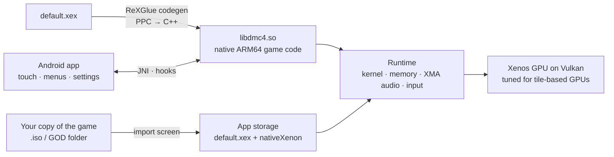

<p align="center">
  
</p>

<p align="center">
  <b>Devil May Cry 4 (Xbox 360) running natively on Android — through static recompilation.</b>
</p>

<p align="center">
  
  
  
  
  
</p>

---

> [!IMPORTANT]
> **No game content is included — and none ever will be.** This repository contains only the
> port itself: the Android app, the native host, the SDK patch, build scripts and tools.
> You need **your own copy** of Devil May Cry 4 for Xbox 360. Builds (APKs) contain code
> recompiled from the game and must not be redistributed.

## What is it

**4DevilTears** turns the Xbox 360 version of Devil May Cry 4 into an Android app. The game's
PowerPC code is recompiled ahead of time into native ARM64 code, the Xbox 360 system and GPU
are provided by a runtime, and everything around it is rebuilt for a phone: touch controls,
menus you can tap, a mobile-tuned Vulkan renderer and an import screen that turns your copy
of the game into a ready-to-play installation.

## Features

| | |
|---|---|
| 📀 **Bring your own game** | First launch asks for the game: a disc image (`.iso`: plain XISO or a full Redump XGD1/2/3 dump) or a *Games on Demand* folder. The layout is detected automatically and the game is unpacked once into the app (~6.5 GB). |
| 🌍 **Editions** | The original release and the Russian fan translation (same executable, translated text and voices). |
| 🎮 **Controls** | On-screen Xbox 360 controller with opacity, fade-when-idle and *essential buttons only* modes. Bluetooth / USB gamepads work out of the box. |
| 🎬 **Cinema mode** | No controls over cutscenes and movies — tap once, tap again to skip. The controller only shows up in gameplay. |
| 👆 **Touch menus** | Tap a menu item to select it, tap again to confirm: title menu, mission screen, mission select, pause. Swipes and two-finger *back* everywhere else. |
| ✨ **TAP to START** | The title screen asks you to *tap*, not to press a button — rebuilt on the device from the game's own lettering. |
| 🖼️ **Display** | Original 16:9, fill or stretch; optional 30 FPS lock for steadier frame pacing; FPS counter. |
| 🔊 **Audio** | 5.1 soundtracks folded to stereo on the device, so dialogue (center channel) is never lost on phone speakers. |

## How it works



1. **Recompilation.** `default.xex` is translated function by function into C++ and compiled
   for ARM64 (`libdmc4.so`). A manifest pins function boundaries the analysis can't find on
   its own.
2. **Runtime.** A patched ReXGlue SDK provides the Xbox 360 kernel,
   memory, file system, XMA audio decoding and input on Android.
3. **Graphics.** The Xenos GPU is emulated on Vulkan with mobile-specific work: render areas
   shrunk to what is actually drawn (tile-based GPUs load and store every tile), hoisted
   uploads, async pipeline compilation with a persistent pipeline cache, MSAA kept 1×,
   and many correctness fixes (texture exponent bias, stale texture detection, …).
4. **Game-aware hooks.** Recompiled functions can be wrapped from the host: the app knows
   when a cutscene, a movie or a menu is on screen, reads the menu cursor and maps taps to
   menu items — without changing the game's own logic.
5. **Android app.** Import screen, game activity on SDL3, touch controller, cinema mode,
   settings panel (Back button or long-press on ◐).

## Getting started

**Playing** — install the APK you built, open **DMC 4**, choose your disc image or Games on
Demand folder and wait for the unpacking to finish. That's it.

**Building** (macOS, Android NDK 28, JDK 17+, Python 3):

```bash
# 1. Unpack your game next to the repository root (needed for recompilation)
python3 tools/xdvdfs_extract.py "/path/to/game.iso or GOD folder" extracted

# 2. Build: patched SDK → recompiled game code → DMC4.apk in the repository root
bash work/build_android.sh

# 3. Install on a phone over adb (optional; see the script header for test modes)
bash work/install_android.sh
```

## Repository layout

| Path | What's inside |
|---|---|
| `work/android/app` | Android app (Java): import screen, game activity, touch controller, settings |
| `work/host` | Native host for the recompiled game: touch bridge, menu / scene hooks |
| `work/patches/4dt-sdk-android.patch` | Changes to ReXGlue SDK v0.10.0: Android, Vulkan / Mali, audio, title screen |
| `work/dmc4_manifest.toml` | Recompilation manifest |
| `work/build_android.sh` · `work/install_android.sh` | Build, install, logs, frame traces, automated tests |
| `work/bench` | Automated test sets (gameplay / cutscene benchmarks) |
| `tools` | Disc & Games on Demand unpacker, MT Framework `.arc` extractor, analysis helpers |

## Status

- [x] Boots, plays cutscenes and missions on Pixel 8 (Mali-G715)
- [x] Import from `.iso` and Games on Demand folders
- [x] Touch controller, cinema mode, touch menus (title, mission, pause)
- [x] Voices and 5.1 audio on phone speakers
- [ ] Touch for the remaining menus (options, library, shop, save / load)
- [ ] Steady 60 FPS in combat; open areas
- [ ] Real widescreen for tall phone screens
- [ ] Russian edition: re-encoded voice tracks that the decoder can't read yet

## Legal

Devil May Cry is a trademark of Capcom Co., Ltd. This project is not affiliated with or
endorsed by Capcom or Microsoft. It ships no game assets and no game code; you must own the
game to use it. Built on ReXGlue SDK and Xenia (BSD-3-Clause).
